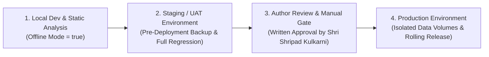

# Platform Deployment & Environment Governance Guide
**Project:** SK Sutras by Shri Shripad Kulkarni — Four-Agent AI-Assisted Platform  
**Technology Implementation Partner:** [Hiranyam AI Labs](https://hiranyamai.com/)  
**Standard:** Enterprise Deployment Isolation, Zero-Data-Mutation, UAT Gate  

---

> [!WARNING]
> **Zero Direct-to-Production Deployment Prohibition**  
> Under strictly enforced Hiranyam AI platform protocols, code and database updates must **NEVER** be deployed directly to any live production environment.  
> Every deliverable must first transition through isolated local development, automated offline unit testing, staging/UAT host deployment, and exhaustive scholarly review before written production approval is granted.

---

## 1. Deployment Environment Architecture



### Environment Isolation Matrix
| Environment | Scope & Host | Database Engine | State Persistence | Live API Access |
| :--- | :--- | :--- | :--- | :--- |
| **Development** | Local Workstation | SQLite (`./data/manuscript.db`) | Local Disk | **Disabled** (`OFFLINE_MODE=true`) |
| **Staging / UAT** | Staging Server (`uat.hiranyamai.com`) | PostgreSQL 14+ / ChromaDB | Host Bind Mounts | Verified Live Key Testing |
| **Production** | Dedicated Production Host | High-Availability PostgreSQL | Persistent Host Volumes | Author-Approved Live Operations |

---

## 2. Mandatory Data Preservation & Backup Protocol

### A. Zero Data Mutation Mandate
Under no circumstances may database records, classical source texts, manuscript version histories, or author review decisions be wiped, truncated, or reset during any container rebuild or application deployment.

### B. Pre-Deployment Automated Backup Script
Prior to rolling out any application update, execute an automated timestamped snapshot:

```bash
#!/usr/bin/env bash
# ==============================================================================
# Script: scripts/pre_deployment_backup.sh
# Purpose: Creates an immutable snapshot of PostgreSQL and ChromaDB stores
# ==============================================================================
set -euo pipefail

BACKUP_TIMESTAMP=$(date +"%Y%m%d_%H%M%S")
BACKUP_DIR="/opt/sk_sutras/backups/${BACKUP_TIMESTAMP}"

mkdir -p "${BACKUP_DIR}"

echo "[Hiranyam AI Backup] Initiating PostgreSQL snapshot..."
pg_dump -U sutras_admin -h localhost -d sk_sutras_production -F c -b -v -f "${BACKUP_DIR}/postgres_backup.dump"

echo "[Hiranyam AI Backup] Archiving ChromaDB vector store..."
tar -czvf "${BACKUP_DIR}/chromadb_backup.tar.gz" -C /opt/sk_sutras/persistent_data/chroma_db .

echo "[Hiranyam AI Backup] Archive created successfully at: ${BACKUP_DIR}"
```

### C. Host-Level Persistent Bind Mount Architecture
Containerized Docker deployments must enforce explicit host bind mounts to decouple the application container lifecycle from stateful records:

```yaml
# docker-compose.prod.yml
version: '3.8'

services:
  app:
    image: hiranyamai/sk-sutras-platform:v1.0.0
    restart: unless-stopped
    ports:
      - "8000:8000"
      - "8501:8501"
    environment:
      - OFFLINE_MODE=false
      - POSTGRES_HOST=postgres
      - CHROMA_PERSIST_DIRECTORY=/app/data/chroma_db
    volumes:
      # Stateful host mounts guarantee data survival across container rebuilds
      - /opt/sk_sutras/persistent_data/db:/app/data/postgres_data
      - /opt/sk_sutras/persistent_data/chroma_db:/app/data/chroma_db
      - /opt/sk_sutras/persistent_data/output:/app/data/output
    depends_on:
      - postgres

  postgres:
    image: postgres:15-alpine
    restart: unless-stopped
    environment:
      POSTGRES_DB: sk_sutras_production
      POSTGRES_USER: sutras_admin
      POSTGRES_PASSWORD_FILE: /run/secrets/db_password
    volumes:
      - /opt/sk_sutras/persistent_data/postgres_storage:/var/lib/postgresql/data
```

---

## 3. Deployment Lifecycle: Staging to Production

### Step 1: Staging / UAT Verification Gate
1. Deploy code to the designated UAT host.
2. Run schema migration script:
   ```bash
   psql -U sutras_admin -d sk_sutras_production -f src/database/migrations/001_initial_schema.sql
   ```
3. Run the automated 5-Sutra Pilot evaluation in controlled live mode:
   ```bash
   python scripts/run_pipeline.py --mode pilot
   ```
4. Verify token consumption and spending metrics in UAT Cost Explorer.
5. Provide the UAT Verification Report to Shri Shripad Kulkarni.

### Step 2: Written Manual Approval Gate
Production release is strictly prohibited until:
- [x] Zero defects reported in UAT testing.
- [x] All 5-sutra pilot outputs reviewed and verified by the author.
- [x] Written manual approval granted by Shri Shripad Kulkarni.

### Step 3: Rolling Production Deployment
1. Take pre-deployment backup (`scripts/pre_deployment_backup.sh`).
2. Pull updated application container image.
3. Perform rolling container restart (`docker-compose -f docker-compose.prod.yml up -d --no-deps app`).
4. Execute healthcheck ping:
   ```bash
   curl -f http://localhost:8000/
   ```
5. Confirm active logging and token metering in production dashboard.
